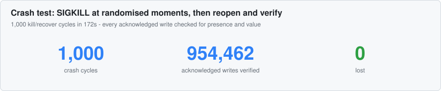
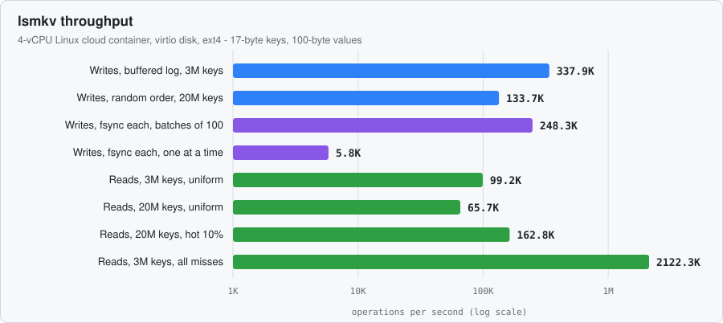

# lsmkv — a crash-resilient LSM-tree storage engine

An embedded, ordered key-value store in Rust, written from the ground up:
write-ahead log, MemTables, SSTables with Bloom filters and sparse indexes,
tombstones, atomically-swapped manifests, leveled compaction, and an LRU block
cache.

The one promise it makes, and the one its test suite is built around:

> **A write that returns `Ok` is never lost.** Kill the process with `SIGKILL`
> at any instant — mid-append, mid-flush, mid-compaction, mid-manifest-commit —
> and every acknowledged write comes back when the database is reopened.

No external crates in the library: the CRC-32C, Bloom filter, LRU, block
format, varint encoding and PRNG are all implemented here. `criterion` is a
dev-dependency for the benchmarks.



Every number on this page is parsed out of a log committed in
[`docs/results/`](docs/results); the charts are regenerated from those logs by
[`scripts/plot_results.py`](scripts/plot_results.py).

---

## Quick start

```rust
use lsmkv::{Db, Options, WriteBatch};

let db = Db::open("/var/lib/mydb", Options::default())?;

db.put("user:1", "ada")?;                  // durable when it returns
assert_eq!(db.get(b"user:1")?, Some(b"ada".to_vec()));

let mut batch = WriteBatch::new();         // applied all-or-nothing
batch.put("user:2", "grace").delete("user:1");
db.write(&batch)?;

// Ordered range scan, merged across the MemTable and every level.
for (key, value) in db.scan(Bound::Included(&b"user:"[..]), Bound::Unbounded)? {
    println!("{} = {}", String::from_utf8_lossy(&key), String::from_utf8_lossy(&value));
}
```

There is a CLI too:

```console
$ cargo run --bin lsmctl -- put ./db greeting hello
$ cargo run --bin lsmctl -- get ./db greeting
hello
$ cargo run --bin lsmctl -- stats ./db
```

---

## How it works

```
   put / delete                                     get
        │                                            │
        ▼                                            ▼
 ┌──────────────┐   1. append + fsync        ┌─────────────────┐
 │ write-ahead  │ ◀───────────────────────── │   MemTable      │  BTreeMap, sorted
 │     log      │   2. apply in memory       │   (mutable)     │
 └──────────────┘                            └─────────────────┘
        │                                            │  full → sealed
        │ replay on open                             ▼
        │                                    ┌─────────────────┐
        │                                    │  MemTable       │  still readable
        │                                    │  (immutable)    │  while it flushes
        │                                    └─────────────────┘
        │                                            │  flush
        ▼                                            ▼
                                             ┌─────────────────┐
                                             │  L0  SSTables   │  may overlap;
                                             └─────────────────┘  newest consulted first
                                                     │  compaction
                                                     ▼
                                             ┌─────────────────┐
                                             │  L1 … L6        │  sorted, disjoint,
                                             └─────────────────┘  10× budget per level
```

### The write path

1. The batch is encoded into one write-ahead-log record, CRC-32C and all.
2. The record is appended and — in `SyncMode::EveryWrite` — `fsync`ed.
3. Only then is the MemTable updated and the call allowed to return.

The order matters: a crash between (2) and (3) replays the record and loses
nothing; a crash before (2) loses a write that never returned, which the
contract allows.

When the MemTable passes `write_buffer_size` it is *sealed* — swapped for a
fresh one behind a fresh log — and a background thread turns it into an
SSTable. Readers keep seeing the sealed table until the flush commits, so a
flush never blocks a reader, and a writer only ever waits if a second flush is
already in flight or level 0 has piled up past `l0_stop_writes_trigger`.

### The read path

MemTable → sealed MemTable → level 0 newest-file-first → one candidate file per
deeper level (found by binary search, since those levels are disjoint). The
first answer wins, and a tombstone counts as an answer: that is what makes a
delete shadow a value still sitting in a deeper level.

Inside a file, a lookup costs at most one block read:

- the **Bloom filter** (10 bits/key, ~1% false positives) usually ends a miss
  before any block is touched;
- the **sparse index** — one entry per block, not per key — binary-searches to
  the single block that could hold the key;
- the **LRU block cache** serves that block from memory if it has been read
  recently.

### On-disk formats

An SSTable:

```
┌────────────────────┐
│ data block 0       │  prefix-compressed entries, restart points every 16
│ data block 1       │
│ …                  │
├────────────────────┤
│ bloom filter block │  one filter over every key in the file
├────────────────────┤
│ index block        │  sparse: last key of each data block → (offset, size)
├────────────────────┤
│ footer (40 bytes)  │  the two handles above, entry count, magic
└────────────────────┘
```

Every block carries a 5-byte trailer (type + CRC-32C), so bit rot or a torn
write surfaces as a `Corruption` error rather than as a plausible-looking wrong
answer.

A log record:

```
u32 crc │ u32 length │ u64 sequence │ u32 count │ entry*
entry := u8 kind │ u32 klen │ key │ u32 vlen │ value
```

The CRC covers the length field too, so a record torn by a power loss cannot be
mistaken for a valid one of a different size.

### Compaction

Level 0 is scored by file count (its files overlap, so every one of them has to
be consulted on a miss); deeper levels are scored by bytes against a budget that
grows 10× per level. The most over-budget level is compacted into the next:
inputs are merged newest-source-first, output rolls over into a new file every
`target_file_size` bytes, and the result is installed with a single manifest
swap. When nothing in the next level overlaps, the file is relabelled instead of
rewritten — a *trivial move*, which costs no I/O at all.

Tombstones are only dropped once no deeper level could still hold an older value
for that key. Dropping one too early would resurrect a deleted record.

### Why a crash cannot corrupt it

Each durable step is ordered so that the state on disk is always a complete,
older version or a complete, newer one:

| Moment of the crash | What recovery finds | What it does |
| --- | --- | --- |
| Mid log append | A record that fails its CRC | Drops the torn tail; replays everything before it |
| After the SSTable is written, before the manifest commit | An SSTable no version names | Deletes the orphan; replays the log that still holds the same data |
| During the manifest commit | `MANIFEST` untouched; a partial `MANIFEST.tmp` | Ignores the temp file — the real manifest is swapped in with `rename(2)`, which is atomic |
| After the manifest commit, before the old log is unlinked | A log whose data is already in an SSTable | Skips every log numbered below the manifest's `log_number` |
| Mid compaction | Output files no version names | Deletes them; the inputs are still in place and still correct |

The manifest is rewritten in full and swapped with `rename`, and the directory
is `fsync`ed after every create, rename and unlink — the step whose absence is
the classic way to "lose" a file that was itself `fsync`ed.

---

## Benchmarks

Two harnesses, because they answer different questions:

```console
cargo bench                                                    # criterion: per-op latency
cargo run --release --bin lsmbench -- --keys 20000000 --random # sustained throughput
python3 scripts/plot_results.py                                # redraw the charts below
```

Measured on a 4-vCPU Linux cloud container (virtio disk, ext4), 17-byte keys and
100-byte values. **Absolute numbers are hardware-bound — the ratios are the
interesting part.**



| Workload | Throughput | Log |
| --- | --- | --- |
| Sequential writes, OS-buffered log, 3M keys | **337.9K writes/sec** | [bench-3m](docs/results/bench-3m.txt) |
| Random-order writes, 20M keys, compacting throughout | **133.7K writes/sec** | [bench-20m](docs/results/bench-20m-random.txt) |
| Writes with `fsync` per write, one at a time | **5.8K writes/sec** | [bench-durability](docs/results/bench-durability.txt) |
| Writes with `fsync` per write, batches of 100 | **248.3K writes/sec** | [bench-durability](docs/results/bench-durability.txt) |
| Random point reads, 3M keys | **99.2K reads/sec** | [bench-3m](docs/results/bench-3m.txt) |
| Random point reads, 20M keys (~1.5 GB on disk, 2.0% cache hit rate) | **65.7K reads/sec** | [bench-20m](docs/results/bench-20m-random.txt) |
| Random point reads over a hot 10% of 20M keys | **162.8K reads/sec** | [bench-20m](docs/results/bench-20m-random.txt) |
| Point reads that all miss, 3M keys (the Bloom filter's home turf) | **2.1M reads/sec** | [bench-3m](docs/results/bench-3m.txt) |

The gap between rows 3 and 4 is the entire cost of durability: an `fsync` per
write is a disk round trip, and batching amortises it **43×**. That is why
`WriteBatch` exists.

The 20M-key run compacted **16.4 GB** while serving those writes, across 826
compactions (286 of them trivial moves), finishing with 7 files in L1, 78 in L2
and 279 in L3.

### What the Bloom filters and the block cache buy

The same data and the same reads, with `bloom_bits_per_key = 0` and a 64 KB
cache. Negative means *faster with them on*.


Three independent runs ([run 1](docs/results/bench-3m.txt),
[runs 2-3](docs/results/bench-3m-repeats.txt)), because one sample of a
percentage is not a result:

| Read workload | Run 1 | Run 2 | Run 3 |
| --- | --- | --- | --- |
| All misses | **−94.0%** | −93.1% | −93.3% |
| Hot set (90% of reads on 10% of keys) | **−45.2%** | −48.3% | −48.7% |
| 50% misses | **−40.1%** | −38.8% | −32.3% |
| All hits, uniform | **+26.6%** | +20.5% | +15.0% |

That last row is the honest one, and it is consistently positive: on an all-hit
uniform workload the filter can never skip a file, and a 64 MB cache in front of
a 320 MB dataset hits only 44% of the time, so the bookkeeping is a net cost of
roughly 15–27%. The filters pay for themselves on misses — which is most of what
a real key-value workload does — and the cache pays for itself on skew. Both are
switchable through `Options`, which is how the comparison above was produced.

---

## Tests

```console
cargo test                                   # unit + integration + a short crash sweep
cargo test --release --test crash -- --ignored --nocapture   # the full 1,000-cycle run
```

- **Unit tests** (in-module) cover the CRC against standard vectors, the Bloom
  filter's false-positive rate, LRU eviction, block prefix-compression and
  seeking, WAL framing and torn-tail handling, manifest encode/decode, and the
  merging iterator's newest-wins rule.
- **`tests/engine.rs`** — put/get/delete, overwrite, resurrection after a
  tombstone, batch atomicity, range scans merged across levels, reopen,
  compaction, concurrent readers against a live writer, binary and empty keys,
  300 KB values.
- **`tests/recovery.rs`** — replay from the log, a torn final record, an orphan
  SSTable from an interrupted flush, a half-written `MANIFEST.tmp`, a tampered
  manifest (must be *reported*, not silently ignored), log reclamation, and ten
  reopens in a row.
- **`tests/crash.rs`** — the real thing. A child process (`lsmctl crash-writer`)
  writes with `fsync` per write and prints `ACK n` only *after* the durable
  `put` returns. The parent `SIGKILL`s it at a random moment, reopens the
  database, and demands that every acknowledged key is present with the right
  value. One variant kills the same directory over and over, so each cycle also
  has to recover from whatever the previous crash left behind.

### Crash-test results

1,000 `SIGKILL`s at randomised moments, 954,462 acknowledged writes checked
afterwards, **none lost** — full log in
[`docs/results/crash-1000.txt`](docs/results/crash-1000.txt):

```console
$ LSMKV_CRASH_ITERS=1000 cargo test --release --test crash -- --ignored --nocapture
running 1 test
cycle 0/1000: 540 acknowledged writes verified so far
cycle 500/1000: 467994 acknowledged writes verified so far
cycle 950/1000: 902383 acknowledged writes verified so far
1000 crash cycles in 172.1s, 954462 acknowledged writes verified, 0 lost
test thousand_crash_cycles ... ok

test result: ok. 1 passed; 0 failed; 0 ignored; 0 measured; 3 filtered out
```

The short sweep that runs as part of `cargo test` does the same thing 20 times,
and CI runs 40.

---

## Layout

```
src/
  lib.rs          public API and the module map
  db.rs           the engine: write path, read path, flush, compaction scheduling
  options.rs      tunables (buffer sizes, level budgets, sync mode)
  wal.rs          write-ahead log: framing, append, replay
  memtable.rs     sorted in-memory table with tombstones
  sst/mod.rs      SSTable writer and reader, footer, Bloom and index blocks
  sst/block.rs    prefix-compressed block format with restart points
  version.rs      FileMeta, Version, and the atomically-swapped manifest
  merge.rs        n-way merging iterator (newest source wins)
  bloom.rs        Bloom filter
  cache.rs        sharded LRU block cache
  table_cache.rs  open-SSTable cache
  crc.rs          CRC-32C (slicing-by-8)
  util.rs         varints, fixed-width ints, hex
  testkit.rs      deterministic keys/values/PRNG shared by tests and benches
  bin/lsmctl.rs   CLI, and the crash-test driver
  bin/lsmbench.rs throughput harness
tests/
  engine.rs       end-to-end behaviour
  recovery.rs     what the engine does with post-crash on-disk state
  crash.rs        SIGKILL a child writer, reopen, verify every acknowledged write
benches/engine.rs criterion micro-benchmarks
docs/results/     raw captured output every number in this README comes from
docs/img/         charts generated from those logs
scripts/          the chart generator
```

---

## Deliberately out of scope

Worth naming, because each is a real feature of a production engine and their
absence is a choice, not an oversight:

- **No MVCC or snapshots.** A key has one live version; readers see the latest.
  Adding them means a sequence number in the internal key and a snapshot list.
- **No compression.** Blocks carry a type byte reserved for it, so Snappy or
  zstd would slot in at `write_raw`/`read_handle`.
- **No single-writer lock file.** Two processes opening the same directory will
  corrupt it. A `flock` on a `LOCK` file is the fix.
- **Writes are serialised** by one mutex. Reads are fully concurrent; writes are
  not, which is why `WriteBatch` matters for throughput.
- **One background thread** does both flushes and compactions.

## License

MIT.
